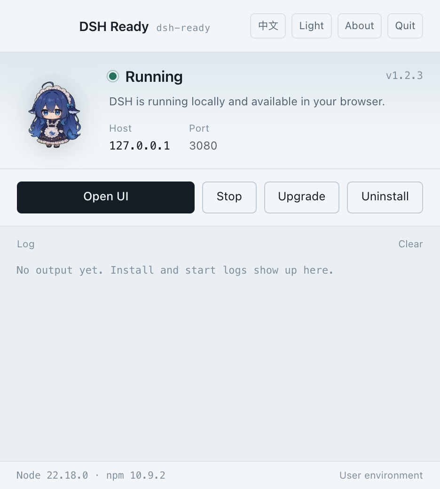
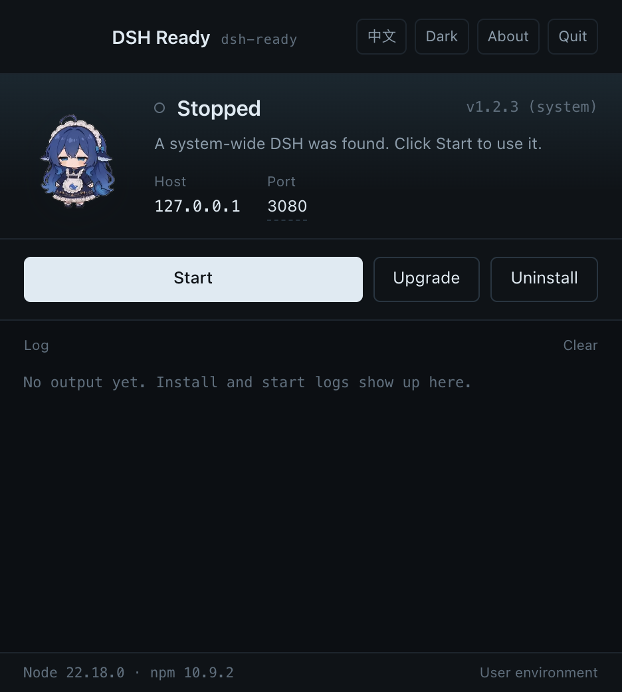

<div align="center">


<h1>DSH Ready · DSH 就位</h1>

<p><strong>One-click desktop launcher for DeepSeek Harness</strong><br />
<sub>装好、启动、升级，全程不用终端</sub></p>

<p>
  <a href="https://dsh.wordtk.com"></a>
  
  
  
</p>

<p>
  <a href="README.zh-CN.md">🇨🇳 中文</a> ·
  🇺🇸 English ·
  <a href="https://dsh.wordtk.com/stats">📊 Usage</a>
</p>

</div>

---

## What is this?

DeepSeek Harness (`dsh`) is a command-line tool. For anyone who does not live in a
terminal, that means installing Node, remembering commands, picking a port, and
cleaning up stray processes.

**DSH Ready is a small desktop window that does those seven things for you:**

| Thing | What happens |
| --- | --- |
| Install | Picks the version, uses your Node/npm (installing Node 22 via nvm into `~/.nvm` when missing), then installs DSH into npm's default global prefix — no sudo |
| Start | Reads your login shell environment, starts `dsh web` on your port, opens it in your browser |
| Stop | Stops the process group it started, or the external instance you asked it to take over |
| Status | Running / stopped / external instance / installing / upgrading, refreshed live |
| Logs | Live output panel plus an on-disk log, so failures are readable |
| Upgrade | Checks every third-party plugin against the target version first, then upgrades DSH and the plugins |
| Uninstall | Stops, removes plugins, clears the profile, removes DSH — keeps `~/.dsh` and your npm setup |

It is deliberately **not** a plugin manager, not a MCP client, not a second DSH UI.
It starts the official web UI in your system browser.

> This is a community project. It is not affiliated with, endorsed by, or maintained
> by DeepSeek.

## Download

| Platform | Installer | Notes |
| --- | --- | --- |
| macOS Apple Silicon | `dsh-ready-1.0.6-arm64.dmg` | M1 / M2 / M3 / M4 |
| macOS Intel | `dsh-ready-1.0.6-x64.dmg` | Intel-based Macs |
| Windows x64 | `dsh-ready-1.0.6-x64.exe` | Windows 10 / 11 |

Grab them from **[dsh.wordtk.com](https://dsh.wordtk.com)** — the installers live on R2
and the site always serves the newest version.

The macOS builds carry an **ad-hoc signature**, so Apple Silicon accepts them without
a paid developer certificate. They are not notarized, so a freshly downloaded copy may
still be blocked once: open **System Settings → Privacy & Security** and choose
**Open Anyway** (macOS 14 and older: right-click the app → **Open**). If macOS claims the
app is damaged, run `xattr -cr "/Applications/DSH 就位.app"`. On Windows, choose
**More info → Run anyway** if SmartScreen appears.

## Screenshots

All screenshots are captured from the real app running inside a sandbox, by
`npm run shots` — no mockups, no compositing.

| Light theme | Dark theme |
| --- | --- |
|  |  |

## How it works

- **System DSH first.** If `dsh` is already installed (npm global, Homebrew), the
  launcher uses it instead of installing a second copy. `dshSource` reports `system`
  or `app` so the UI can say which one is live.
- **Login shell environment.** Apps launched from Finder inherit launchd's minimal
  environment. DSH Ready runs `$SHELL -ilc 'env -0'` once and merges the result, so
  API keys, proxies and `PATH` from `~/.zshrc` work exactly like in your terminal.
  Skip it with `DSH_READY_SKIP_SHELL_ENV=1`.
- **One instance, one port.** It polls every 4 seconds for a `dsh web` listening on
  the target port; if something else runs there you can stop it or take it over.
  DSH on other ports is never touched.
- **Upgrade plan before upgrade.** Plugin `peerDependencies` on `@deepseek-ai/dsh*`
  and `engines.dsh` are checked against the target version. A blocker is reported
  and nothing is touched; only a passing plan turns into executable commands.
- **Ports stay yours.** The default is 3080 and it is editable in the UI; a busy
  port is reported instead of silently shifted, so the address you see is real.
- **About and updates.** The About panel shows the developer contact and checks the
  published version; the app also asks the site once a day and offers a jump to the
  download page when something newer exists.
- **Your Node, your environment.** DSH Ready uses the Node and npm from your login
  shell. When Node is missing (or older than 22.18, or has no npm), it benchmarks the official and the China mirror, installs nvm
  into `~/.nvm`, installs Node 22 as the default, and appends the nvm init block to
  your shell profile. DSH itself is installed with a plain `npm install -g`, never a
  private `--prefix`.

## Repository layout

```text
electron/            main process (install, run, upgrade, IPC, logging)
renderer/            the window: HTML, CSS, vanilla JS, whale-girl animation
site/                dsh.wordtk.com — Cloudflare Worker + static assets + D1/KV/R2
  src/index.js       /api/* : release manifest, ranged downloads, anonymous counts
  public/            the site itself (static-first, one theme)
  migrations/        D1 schema (ready_* tables)
scripts/             sandbox launcher + screenshot capture + release helpers
docs/zh, docs/en     design and deployment notes, one directory per language
```

## Development

```sh
npm install
npm start                    # run the desktop app
npm run sandbox              # run it against an isolated DSH_HOME + app data dir
npm run shots                # real in-app screenshots, then the sandbox is removed
npm run dist:mac:arm64       # build the Apple Silicon dmg
npm run dist:mac:x64         # build the Intel dmg
npm run dist:win             # build the Windows installer
```

The sandbox (`scripts/sandbox-test.sh`, `scripts/capture-screenshots.mjs`) sets
both `DSH_HOME` and Chromium's `--user-data-dir` to a temp directory, uses a random
debugging port, and deletes everything on exit. Your `~/.dsh`, your settings, and any
DSH you already have running are never touched.

The website lives in `site/`:

```sh
cd site
npm install
npm run dev                  # wrangler dev
SITE_URL=https://example.com npm run deploy
npm run release              # upload installers to R2 + rewrite latest.json
```

## Privacy

- The desktop app sends **nothing**. No telemetry, no update pings, no accounts.
- The website itself collects **nothing** — no page-view counter, no cookies, no
  third-party scripts. The only data on this project's side is an anonymous launch
  signal sent by the desktop app: a random device id, the UTC date, the app version
  and Cloudflare's coarse geo (country / region / city). No IP addresses, no
  fingerprints, no user behaviour. The aggregates are public at
  [dsh.wordtk.com/stats](https://dsh.wordtk.com/stats).

## License

**AGPL-3.0-only.** Free for personal use, learning, research and open-source
projects. If you want to ship a modified version inside a closed-source commercial
product, a commercial licence is required — please open an issue to get in touch:

<https://github.com/onblog/dsh-ready/issues>

## Built with

Electron for the desktop app. The site runs on Cloudflare Workers with D1, KV and R2.
