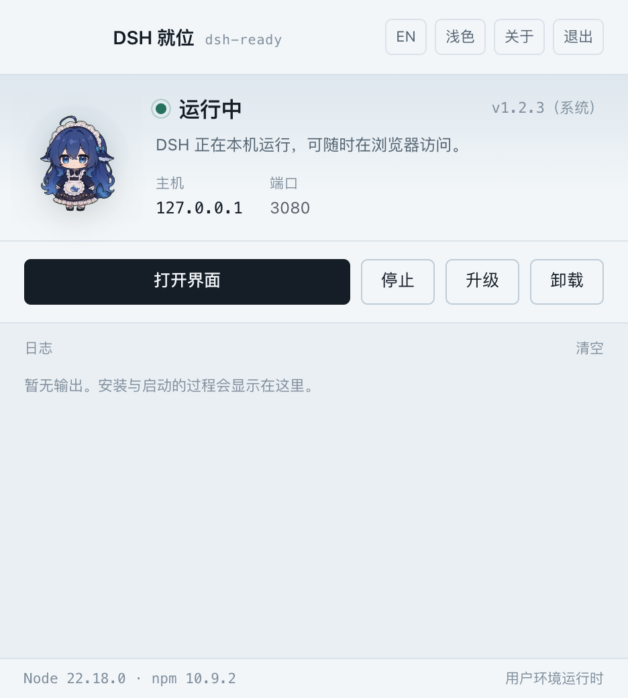
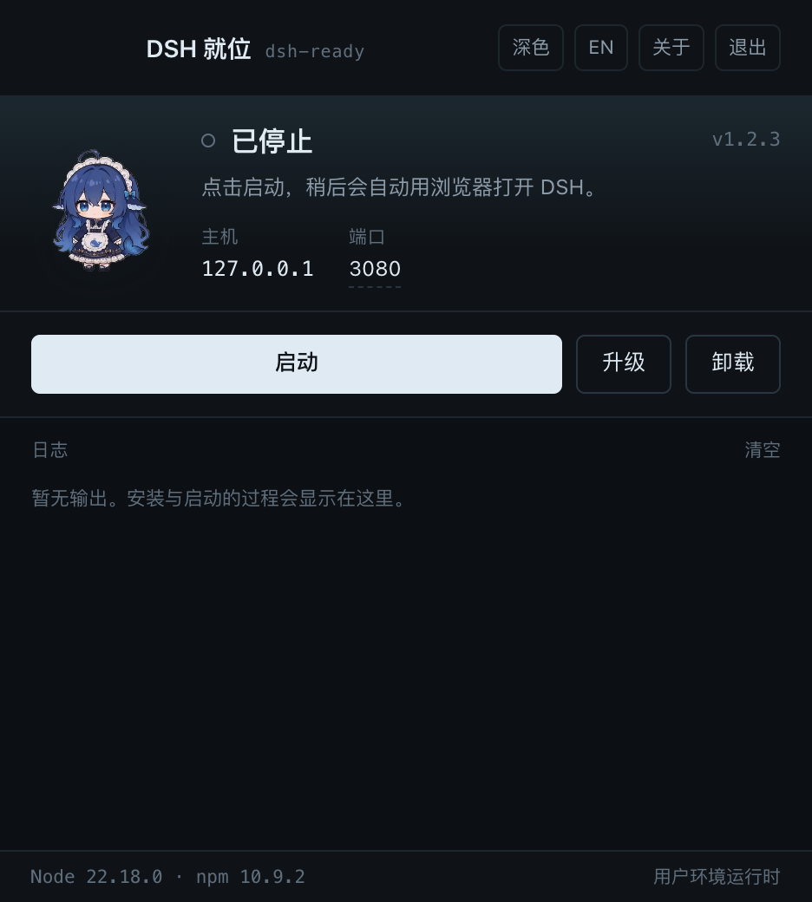

<div align="center">


<h1>DSH 就位 · DSH Ready</h1>

<p><strong>DeepSeek Harness 的桌面启动器</strong><br />
<sub>装好、启动、升级，全程不用终端</sub></p>

<p>
  <a href="https://dsh.wordtk.com"></a>
  
  
  
</p>

<p>
  🇨🇳 中文 ·
  <a href="README.md">🇺🇸 English</a> ·
  <a href="https://dsh.wordtk.com/stats">📊 使用数据</a>
</p>

</div>

---

## 这是什么？

DeepSeek Harness（`dsh`）是一个命令行工具。对不常待在终端里的人来说，这意味着要装 Node、记命令、挑端口，还要收拾跑飞的进程。

**DSH 就位就是一个蓝色小窗口，替你做这七件事：**

| 事情 | 具体做了什么 |
| --- | --- |
| 安装 | 选版本 → 用你环境里的 Node/npm（缺 Node 时用 nvm 装到 `~/.nvm`）→ 用 npm 默认全局前缀安装 DSH，不需要 sudo |
| 启动 | 读取登录 shell 环境，用你的端口启动 `dsh web`，就绪后自动打开系统浏览器 |
| 停止 | 停止自己启动的进程组，或你确认接管的外部实例 |
| 状态 | 运行中 / 已停止 / 外部实例 / 安装中 / 升级中，实时刷新 |
| 日志 | 实时日志面板 + 落盘日志，失败时能看出卡在哪一步 |
| 升级 | 先逐个核对第三方插件的 DSH 兼容范围，通过后才升级 DSH 与插件 |
| 卸载 | 停实例 → 卸插件 → 清 profile → 卸本体，但保留 `~/.dsh` 与 npm 环境 |

它刻意**不做**插件管理、不做 MCP 客户端、不重做 DSH 界面 —— 只启动官方 Web 界面并交给系统浏览器。

> 这是社区项目，与 DeepSeek 官方没有隶属或背书关系。

## 下载

| 平台 | 安装包 | 说明 |
| --- | --- | --- |
| macOS Apple Silicon | `dsh-ready-1.0.7-arm64.dmg` | M1 / M2 / M3 / M4 |
| macOS Intel | `dsh-ready-1.0.7-x64.dmg` | Intel 芯片的 Mac |
| Windows x64 | `dsh-ready-1.0.7-x64.exe` | Windows 10 / 11 |

到 **[dsh.wordtk.com](https://dsh.wordtk.com)** 下载：安装包放在 R2，官网永远提供最新版本。

macOS 安装包带 **ad-hoc 签名**，Apple Silicon 可直接运行，但没有做苹果公证。下载后首次打开可能被系统拦一次：到「系统设置 → 隐私与安全性」点「仍要打开」（macOS 14 及更早可右键图标选「打开」）。若提示「已损坏」，执行 `xattr -cr "/Applications/DSH 就位.app"`。Windows 上点「更多信息 → 仍要运行」即可。

## 界面截图

所有截图都由 `npm run shots` 在沙箱里真实启动应用后截取，不是效果图，也没有后期拼贴。

| 浅色主题 | 深色主题 |
| --- | --- |
|  |  |

## 它是怎么做到的

- **只用你环境里的 Node 与 npm。** 启动时读取登录 shell 的 Node/npm 并打印版本；缺 Node、版本低于 22.18 或缺 npm 时，用 nvm 把 Node 22 装到 `~/.nvm` 并写入 shell 配置。DSH 用普通的 `npm install -g` 安装，不使用应用私有的 `--prefix`。
- **登录 shell 环境。** 从 Finder 启动的图形应用只有 launchd 的精简环境。应用会执行一次 `$SHELL -ilc 'env -0'` 再合并，`~/.zshrc` 里的 API Key、代理、`PATH` 都能生效，和终端里手敲一致。想跳过就设 `DSH_READY_SKIP_SHELL_ENV=1`。
- **只有一个实例、一个端口。** 每 4 秒扫描一次监听目标端口的 `dsh web`，发现外部实例可以停止或一键接管；其它端口的 DSH 一律不碰。
- **先出升级计划，再动手。** 逐个核对插件声明的 `@deepseek-ai/dsh*` peer 范围与 `engines.dsh`，有阻塞项只提示、不改环境；检查通过才把命令列出来并执行。
- **端口不偷偷改。** 默认 3080，可在界面上改；端口被占用时直接报错，而不是悄悄顺延到你找不到的地址。
- **关于与更新。** 右上角「关于」里有开发者联系方式，可手动检测更新；应用每天也会自动问一次官网，有新版本时提示并可一键跳转下载页。
- **缺 Node 才安装。** 检测登录 shell 里的 Node ≥ 22.18 与 npm；缺失时先测速官方源与国内镜像，再用 nvm 把 Node 22 装到 `~/.nvm` 并写入 shell 配置，不占用应用目录。

## 目录结构

```text
electron/            主进程（安装、运行、升级、IPC、日志）
renderer/            窗口界面：HTML + CSS + 原生 JS + 鲸鱼娘动画
site/                dsh.wordtk.com：Cloudflare Worker + 静态资源 + D1/KV/R2
  src/index.js       /api/*：版本清单、分段下载、匿名计数
  public/            官网本体（纯静态优先，单一主题）
  migrations/        D1 表结构（ready_* 前缀）
scripts/             沙箱启动、真实截图、发布辅助脚本
docs/zh, docs/en     设计与部署文档，按语言分目录
```

## 本地开发

```sh
npm install
npm start                    # 启动桌面应用
npm run sandbox              # 隔离 DSH_HOME 与应用数据目录后启动
npm run shots                # 沙箱内真实截图，结束自动清理
npm run dist:mac:arm64       # 打 Apple Silicon dmg
npm run dist:mac:x64         # 打 Intel dmg
npm run dist:win             # 打 Windows 安装包
```

沙箱（`scripts/sandbox-test.sh`、`scripts/capture-screenshots.mjs`）会把 `DSH_HOME` 和 Chromium 的 `--user-data-dir` 一起指到临时目录，用随机调试端口，退出即删除。你的 `~/.dsh`、设置和正在运行的 DSH 都不会被读写。

官网在 `site/`：

```sh
cd site
npm install
npm run dev                  # wrangler dev
SITE_URL=https://example.com npm run deploy
npm run release              # 上传安装包到 R2 并重写 latest.json
```

## 隐私

- 桌面应用**不上报任何数据**：没有埋点、没有更新检查、没有账号。
- 官网本身**不做任何统计**：没有页面访问计数、不设 Cookie、无第三方脚本。项目侧唯一的数据是桌面应用上报的匿名启动信号（随机设备 ID、UTC 日期、版本号，以及 Cloudflare 的粗略地区）。不写 IP、不写设备指纹、不记录使用行为。聚合数据公开在 [dsh.wordtk.com/stats](https://dsh.wordtk.com/stats)。

## 许可

**AGPL-3.0-only。** 个人使用、学习、研究、开源项目都免费。若要把修改版放进闭源商业产品，需要商业授权，请通过 issue 联系：

<https://github.com/onblog/dsh-ready/issues>

## 技术栈

桌面端基于 Electron；官网运行在 Cloudflare Workers 上，使用 D1、KV 与 R2。
